# 知识库 · 使用手册

> 这份手册假设你**完全不懂技术**。照着做就行，每一步都有图。
> 全流程大约 10 分钟能上手。

---

## 一、这是个什么东西

一个**装在你自己的电脑上**的笔记软件。你用浏览器打开它，写笔记、传图片、搜索、整理目录。

数据存在你自己电脑的一个文件里，不上传任何服务器 —— 除非你自己开了「公网访问」（见第十一节），那时候也只有你自己能决定给谁看。

**它能干什么**：写笔记（支持 Markdown）· 中文全文搜索 · 目录分类 · 标签 · 笔记之间互相链接 · 插入图片 · 历史版本 · 回收站 · 导入导出 · 手机/平板也能用。

---

## 二、第一次使用：三步

### 第 1 步：启动

打开知识库所在的文件夹，进入 `scripts` 目录，**双击 `start.cmd`**。

会弹出一个黑色窗口，里面滚动一堆文字。**第一次会比较慢**（要下载依赖，可能几分钟），屏幕上会提示「首次构建需要几分钟」，属正常现象。

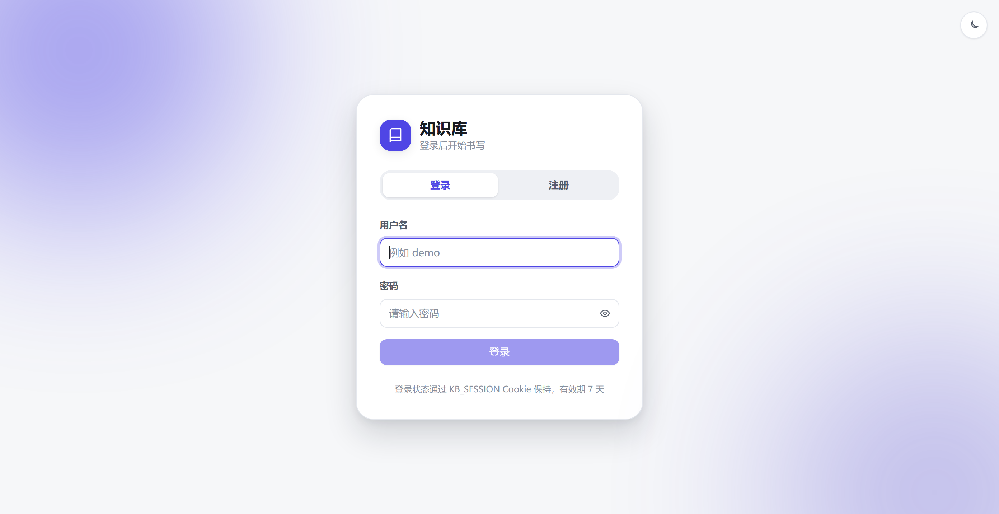

> 图：启动成功后，用浏览器打开窗口里打印的地址，看到的就是这一页（登录/注册页）。第一次用先点「注册」。

等它最后打印出这样两行地址，就说明好了：

```
本机：    http://127.0.0.1:8080
局域网：  http://192.168.1.xx:8080
```

> ⚠️ **这个黑窗口不能关**。关掉窗口，知识库就停了。想关的时候直接关窗口即可。

#### 如果提示「端口 8080 已被占用」

8080 是个很热门的端口，电脑上别的程序（开发工具、别的服务）经常占着它。有两种解法：

**解法一：换个端口启动**（推荐，不影响别的程序）

```
scripts\start.cmd -Port 8081
```

然后浏览器访问 `http://127.0.0.1:8081` 即可。想固定下来，也可以设环境变量：
```
set KBPORT=8081
scripts\start.cmd
```

**解法二：把占着 8080 的那个程序关掉**

启动器会把占用者的名字打印出来，照着关掉再重试，然后就能用默认的 `http://127.0.0.1:8080`。

> 💡 **换端口后记得改地址**：`打开知识库.cmd` 固定打开 8080，换端口时请直接在浏览器里输 `http://127.0.0.1:8081`。
> 换端口**不影响数据** —— 笔记还是存在同一个 `data\kb.db` 里。

### 第 2 步：打开网页

最省事的方法：**双击 `scripts\打开知识库.cmd`**，它会自己打开浏览器。

或者手动打开浏览器（Edge / Chrome 都行），在地址栏输入：

```
http://127.0.0.1:8080
```

### 第 3 步：注册账号

第一次打开会看到登录页。**第一个注册的账号自动成为管理员**（不需要邀请码）。

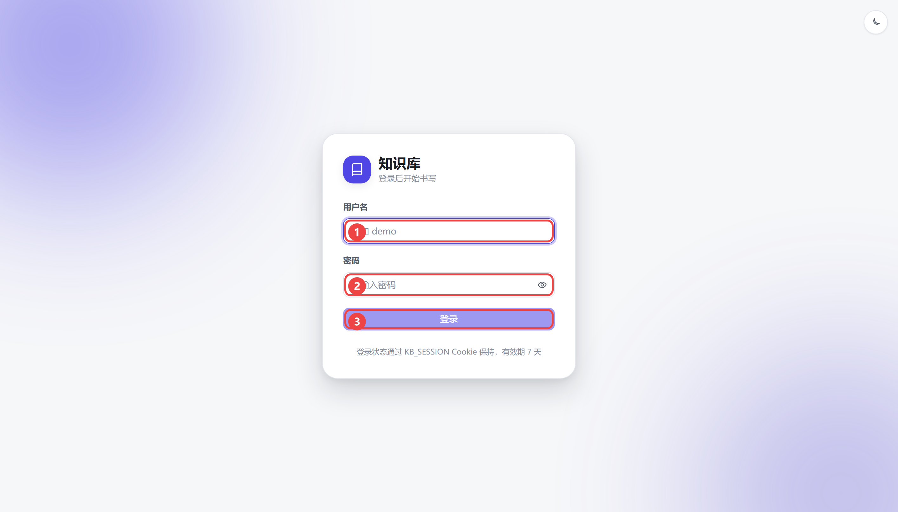

1. 填一个用户名（3–32 位，字母数字下划线减号）
2. 填密码（至少 8 位）
3. 点「登录」下方的注册入口

> 💡 **密码请设强一点**。如果你后面要开公网访问，任何拿到地址的人都能看到这个登录页。

**之后要给别人开号**：用管理员账号进「成员管理」，生成一个邀请码发给对方，对方注册时填上即可。

---

## 三、界面认识

登录后就是这个界面，一共三块：

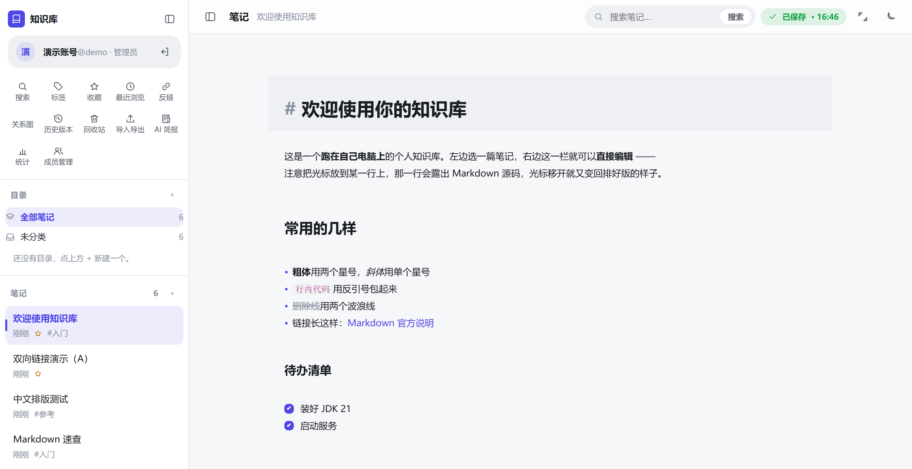

| 编号 | 区域 | 干什么用的 |
|---|---|---|
| **①** | **顶栏** | 当前笔记名 · 搜索框 · 收藏 ⭐ · 保存状态 · 主题切换 |
| **②** | **目录树 + 笔记列表** | 上半部分是目录，下半部分是笔记列表 |
| **③** | **编辑区** | 你的正文就写在这里 |

左侧栏最上方一排小图标是功能入口，共 **13 项**（成员管理只管理员可见）：笔记、搜索、标签、**收藏**、最近浏览、反链、**关系图**、历史版本、回收站、导入导出、**AI 简报**、**开源周报**、统计。点一下就切过去，再点「笔记」回到编辑。

### 收起左栏

点顶栏最左边的图标可以收起左栏，编辑区会变宽。再点一下展开。**窄屏幕（手机/平板）上左栏默认是收起的**，点顶栏左边的「菜单」图标把它滑出来。

### 宽屏 / 窄栏（看表格和大图时很有用）

编辑区默认是 **860px 的窄栏**（居中的一列文字）—— 这是为了让长文好读：一行字数太多，眼睛来回扫会很累。

但看**宽表格、大图、长代码块**时窄栏就不够用了。顶栏有一个**宽屏/窄栏切换**按钮：

- **窄栏**：860px 居中，适合读长文
- **宽屏**：占满整个可用宽度，适合看表格和大图

选择会被记住，刷新后保持。手机/平板上不显示这个按钮（本来就没留白）。

### 深色主题

点顶栏最右边的月亮/太阳图标切换。切换后刷新也不会丢。

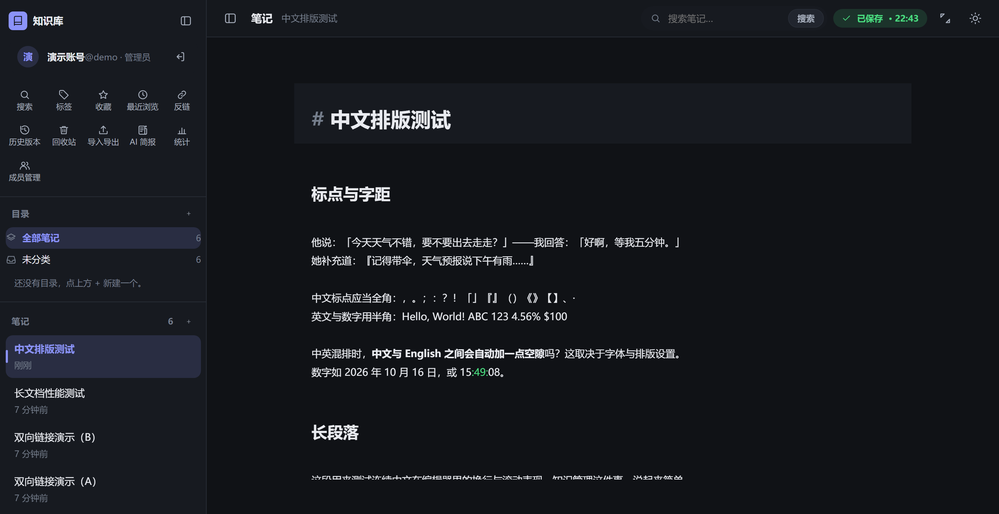

---

## 四、写笔记

### 新建

点笔记列表标题右边的 **「+」**，就新建一篇。

### 最重要的一个特性：光标在哪一行，那一行才显示「原始格式」

这是这个编辑器最不一样的地方，**一定要试一下**：

**把光标点在第一行（标题那一行）上**，你会看到原始的 `#` 号：

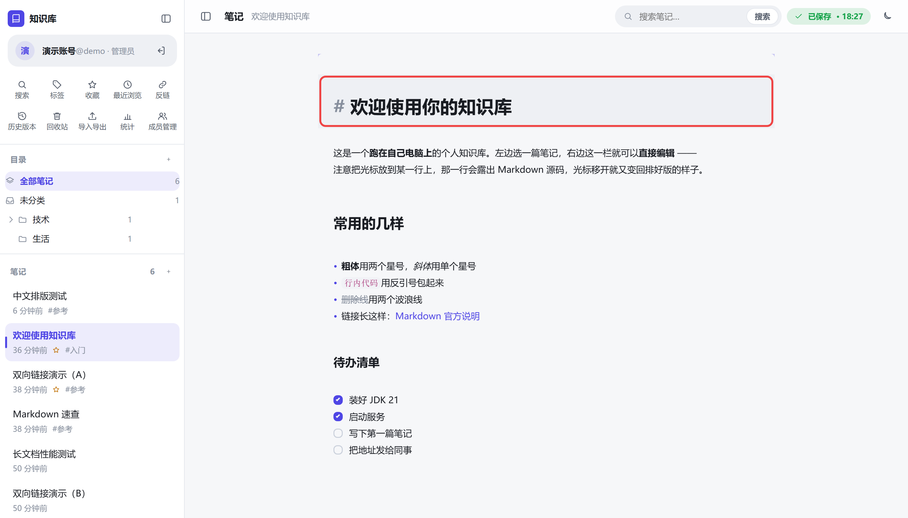

**把光标点到别的地方**，`#` 就消失，变成排好版的标题：

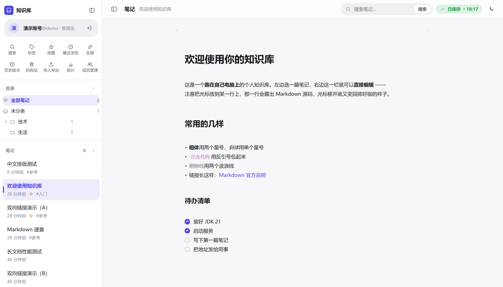

**为什么要这样设计？** 因为这样你既能直接改格式符号（比如想把二级标题改成一级，只要删一个 `#`），又不用一直盯着满屏的符号看。写作时看排版，改格式时光标移过去就行。

### 常用写法

| 你想要 | 输入这个 |
|---|---|
| 大标题 | `# 标题` |
| 中标题 | `## 标题` |
| **粗体** | `**粗体**` |
| *斜体* | `*斜体*` |
| ~~删除线~~ | `~~删除线~~` |
| 行内代码 | `` `代码` `` |
| 无序列表 | `- 项目` |
| 有序列表 | `1. 项目` |
| 待办清单 | `- [ ] 待办` / `- [x] 已完成` |
| 引用 | `> 引用内容` |
| 分隔线 | `---` |
| 链接 | `[文字](网址)` |
| 代码块 | 三个反引号包起来 |
| 表格 | 用 `|` 分隔，见下 |

表格写法：

```
| 姓名 | 年龄 |
|---|---|
| 张三 | 18 |
```

### 待办清单能点

写 `- [ ] 待办事项`，渲染出来后是**真的复选框**，点一下就能勾上。

### 选中文字就能排版（格式工具栏）

**用鼠标选中一段文字**，上方会浮出一个工具栏：

```
加粗 · 斜体 · 删除线 · 下划线 · 高亮 · 文字颜色 ▾ · 背景颜色 ▾ · 行内代码 · 链接 · 清除格式
```

- 点一下就套用；**再点一次取消**（比如已经加粗了，再点「加粗」就去掉）
- 「文字颜色」「背景颜色」点开会弹出调色板，点颜色即可
- 「清除格式」把选中的文字**所有**格式一次剥掉

**用键盘也一样**（不用去点工具栏）：

| 按键 | 作用 |
|---|---|
| `Ctrl + B` | 加粗 |
| `Ctrl + I` | 斜体 |
| `Ctrl + U` | 下划线 |
| `Ctrl + E` | 行内代码 |
| `Ctrl + K` | 插入链接 |

> 💡 **两种格式的区别**
> 加粗、斜体、删除线、行内代码、链接是 **Markdown 原生语法**，导出到任何笔记软件都正常。
> 下划线、高亮、文字颜色、背景颜色是 **内联 HTML**（`<u>` `<mark>` `<span style>`）——
> Typora、VS Code、Obsidian 都能正常显示，但**纯文本的 Markdown 查看器会看到标签**。
>
> 如果这篇笔记将来要导出给只认纯 Markdown 的工具，建议少用这四种。

> 在**代码块里**选中文字不会弹工具栏（避免把格式套进代码）。

### 快捷键

| 按键 | 作用 |
|---|---|
| `Ctrl + S` | 立刻保存（平时不用按，会自动保存） |
| `Ctrl + B` | 加粗 |
| `Ctrl + I` | 斜体 |
| `Ctrl + U` | 下划线 |
| `Ctrl + E` | 行内代码 |
| `Ctrl + K` | 插入链接 |
| `Ctrl + Z` / `Ctrl + Y` | 撤销 / 重做 |
| `Ctrl + C` / `Ctrl + V` / `Ctrl + X` | 复制 / 粘贴 / 剪切 |
| `Tab` | 列表里缩进一层 |

> 顶栏右侧会显示「未保存 / 正在保存 / 已保存」。**平时不用管，它自己会存**（停止输入约 1 秒后自动保存）。

### 长笔记看不完？上面有个「速览」

超过 800 字的长笔记，编辑器**上方**会多出一行折叠条，写着 **「速览（自动提取）」**。点开是这样：

- 第一行：这篇笔记的第一个标题
- 接着：正文里前几个段落的首句

这样你不用从头读，先扫一眼就知道这篇讲什么。**默认是折叠的**，不占地方；展开/收起的状态会记住，下次还是你上次的样子。

> ⚠️ **「自动提取」是字面意思** —— 它只是从你写的正文里**挑句子**，不是 AI 改写、也不会编造内容。
> 你的正文一个字都不会被改动。短于 800 字的笔记不会出现这个条。

---

## 五、整理笔记：目录

左栏上半部分是目录树。

| 操作 | 怎么做 |
|---|---|
| 新建目录 | 点目录树右上角的 **「+」** |
| 展开/收起 | 点目录名左边的三角 |
| 新建子目录 | 鼠标移到目录名上，点出现的小加号图标 |
| 改名 | 鼠标移到目录名上，点铅笔图标 |
| 删除 | 鼠标移到目录名上，点垃圾桶图标 |
| **把笔记移进目录** | **直接拖动**笔记列表里的那条，拖到目录上松手 |
| 把目录移到别的目录下 | 同样直接拖 |

> 删除目录时，**它会连同里面的子目录和笔记一起进回收站**，确认框里会写清楚影响多少篇。不是彻底删除，还能捞回来（见第八节）。
>
> 移动失败（比如把目录拖进它自己的子目录）会自动弹回原位，不会弄坏结构。

顶部两个特殊条目：

- **全部笔记** —— 显示所有笔记
- **未分类** —— 只显示没放进任何目录的笔记

### 删除一篇笔记

在左栏的笔记列表里，**鼠标移到那一行**，右侧会出现一个 **「⋯」** 按钮：

```
⋯  →  删除
```

点「删除」后会让你确认一次，确认后笔记**移入回收站**（不是彻底删除，随时能恢复）。

> 💡 如果你删的正好是当前打开的那篇，会自动跳到列表里的下一篇。
>
> 回收站在顶栏的功能图标里，进去可以恢复或彻底删除。详见第九节。

---

## 六、快速找到笔记

### 搜索

在顶栏的搜索框里打字，**支持 1 个汉字起搜**（很多搜索工具做不到，它行）。

例如搜「天气」：

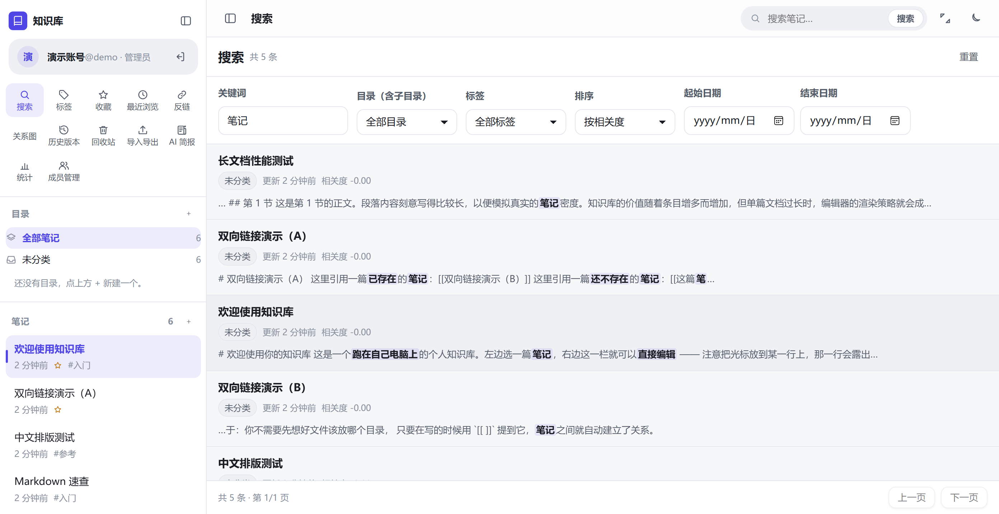

1. 在顶栏搜索框输入关键词
2. 下方便是结果，命中的字会**高亮**
3. 点结果就能打开那篇笔记
4. 每条结果下面还有一行**「命中片段」** —— 直接显示关键词出现在正文的哪句话里（加粗的那个词就是命中处）

#### 结果太多？用筛选条

搜索结果页顶部有一排筛选条件，可以叠加使用：

| 筛什么 | 说明 |
|---|---|
| **目录** | 选「技术」就只搜技术目录下的笔记，**包括它下面所有子目录**；选「未分类」只搜没放进目录的 |
| **标签** | 只看打了某个标签的 |
| **日期范围** | 起止都填，**当天算在内**。比如只想看这个月写的东西 |
| **排序** | 「相关度」（默认，最像的排前面）／「最近更新」（刚改过的排前面） |

- 筛选条件不同，结果数会实时变，标题上会有「共 N 条 · 已筛选」的提示
- 点「清空筛选」一键回到只有关键词的状态
- **筛选状态会写进地址栏**（形如 `#/search?q=权限&folderId=0&from=2026-10-01`），
  刷新页面或把这个链接收藏起来，下次打开还是同样的筛选结果

### 标签

给笔记打标签，然后按标签找。

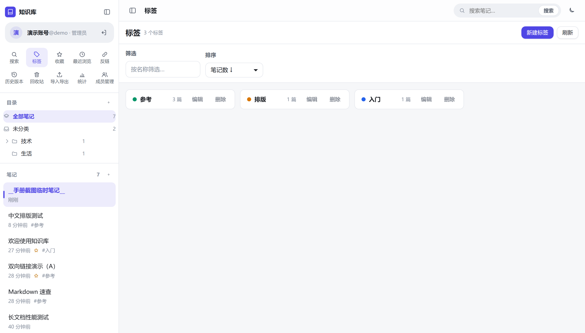

- 新建标签时可以挑颜色
- 点某个标签 → 直接跳到「搜索」，并把该标签作为筛选条件
- 删除标签只是解除关联，**不会删掉笔记**

给笔记打标签：在「搜索」视图按标签筛，或者在笔记列表里选中笔记后用标签功能。

### 收藏 / 最近浏览

- **收藏**：把重要的笔记收进「收藏」清单，随时能找到。收藏方法有两种：
  1. 在左侧笔记列表里点该笔记右侧的「⋯」→「**收藏**」（再次点同一处可取消收藏）；
  2. 打开该笔记后，点**顶栏的 ⭐**（已收藏时图标会变色，再点即取消）。
  收藏不会产生新版本，取消收藏也不会删除笔记。
- **最近浏览**：按你打开的时间倒序，刚看过的排最前

（这两个入口在左侧栏的功能图标里，点一下就能切过去。）

### 统计

想知道自己写了多少、最近有没有坚持写，看「统计」：

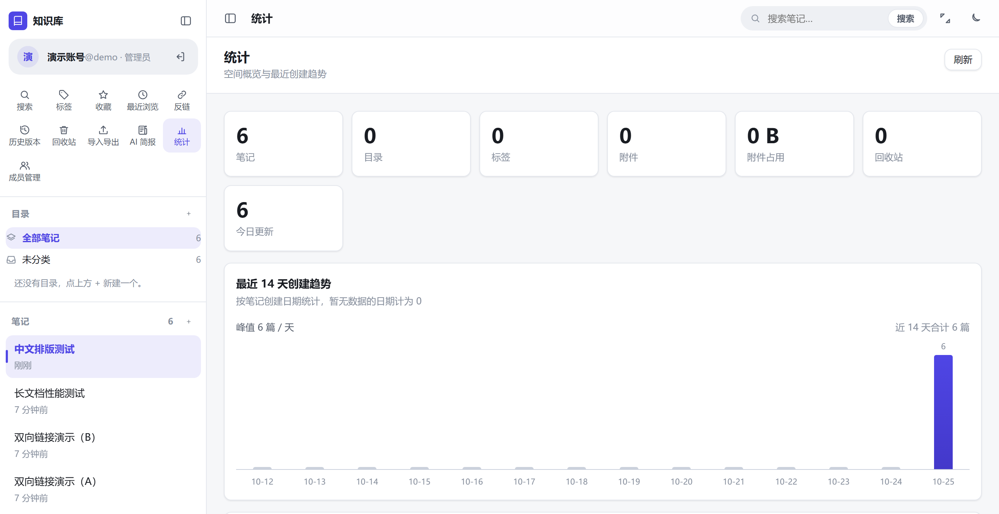

显示笔记总数、目录数、标签数、附件占用空间、回收站条目数，以及**最近 14 天每天新建了几篇**的柱状图。

---

### AI 简报

点顶栏的「AI 简报」，这一页管一件事：**把网上当天的 AI 新闻汇总成一篇笔记存进你的库**。

页面三块：

| 区块 | 干什么 |
|---|---|
| **立即生成** | 点一下马上抓一次，抓完告诉你一共几条、新收录几条，并给出生成的笔记入口 |
| **源状态** | 列出 10 个来源（OpenAI、Google DeepMind、Anthropic、Techmeme、Hacker News、量子位、机器之心、arXiv、Hugging Face、Import AI）能不能取到。标着「已知不可达」的源是**故意跳过**的，不算故障 |
| **运行历史** | 每次抓取的时间、状态、条数；同一条新闻不会被重复收录 |

生成的是一篇**普通笔记**，存在配置的目录里（默认目录名由管理员在配置文件里定）。你可以像别的笔记一样搜它、改它、导出它。

> ⚠️ **这个功能要联网**。公司网断着的时候点「立即生成」会失败，属正常；稿子没抓到不影响你已有的笔记。
>
> ⚠️ 如果管理员把简报功能关掉了，点「立即生成」会直接提示「**简报功能已关闭（kb.briefing.enabled=false），已拒绝执行，未发起任何外网请求**」。看到这句话不用重试，找管理员开。
>
> 💡 一次抓取大约 10–20 秒。页面会转圈，**别连点**（同一时间只允许一个任务在跑，第二次点会提示稍后重试）。

---
## 七、把两篇笔记连起来（双向链接）

这是知识库比普通文件夹强的地方：**笔记之间可以互相引用，而且引用是双向可见的。**

### 怎么建链接

在正文里输入两个左方括号，会**自动弹出候选列表**：

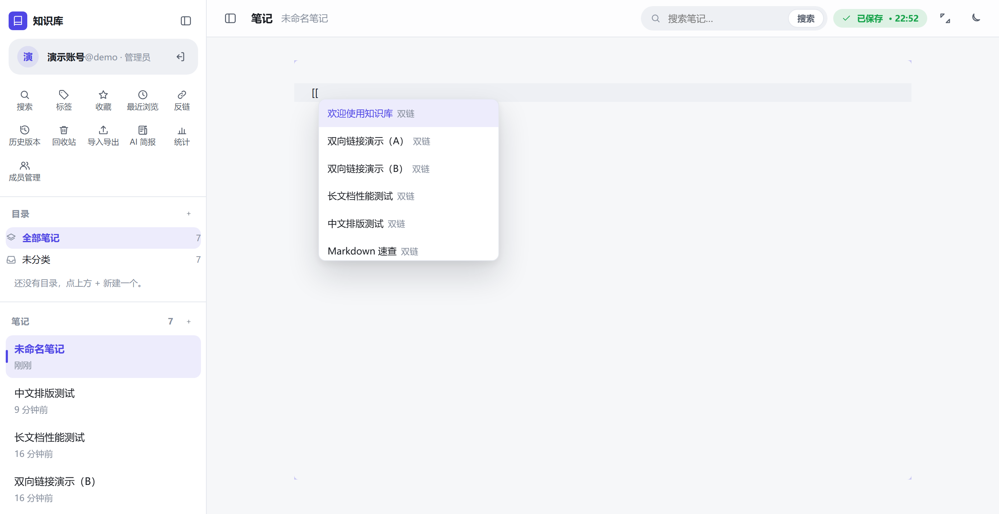

- 用 ↑↓ 选择，回车插入
- 也可以直接用鼠标点
- 按 Esc 取消

插入后形如 `[[另一篇笔记的标题]]`。

### 两种颜色代表两种状态

- **正常颜色**（例如「双向链接演示（B）」）= 那篇笔记已经存在，点一下就跳过去
- **虚线/灰色**（例如「这篇笔记还没写」）= 那篇笔记还不存在，点它会问你要不要现在创建

### 反向链接

打开一篇笔记，点顶栏的「反链」，能看到：

- **反向引用**：哪些笔记引用了**我**
- **出链**：我引用了**谁**

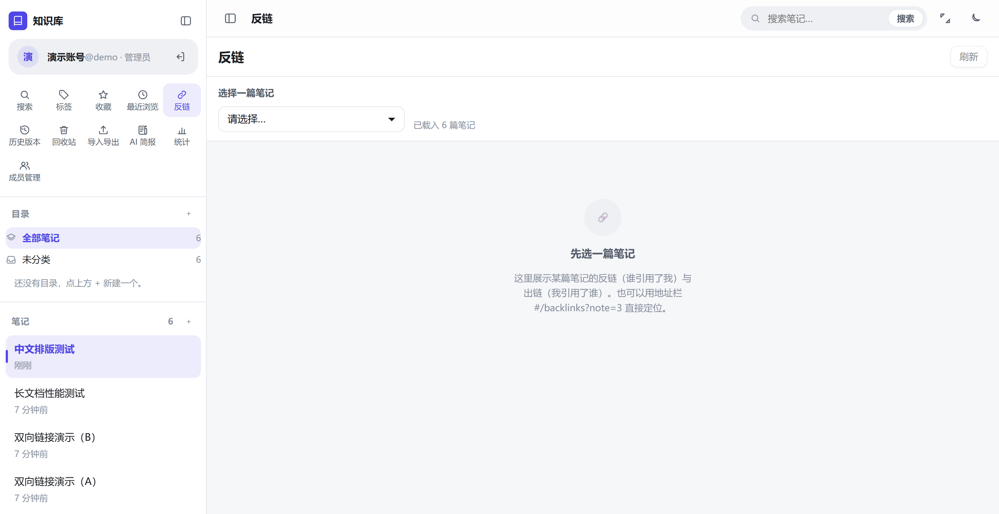

> 不用手动维护 —— 你改标题、删链接，反链会自动跟着变。

### 关系图：一眼看到笔记之间的关系

侧栏点**「关系图」**，你会看到一张图：每篇笔记是一个节点，笔记之间的 `[[双链]]` 是一条连线。

怎么用：

- **拖动节点** —— 把挤在一起的分开
- **滚轮缩放**，**拖动空白处平移**
- **鼠标停在某个节点上** —— 和它相连的线会亮起来，方便看它连了谁
- **点节点** —— 直接打开那篇笔记

两种情况会看到不同结果：

| 你看到的 | 说明 |
|---|---|
| 一堆分散的点，彼此没连线 | 这些笔记之间还没有双链。在正文里写 `[[另一篇的标题]]` 就会连起来 |
| 有一圈孤零零的点在主群外面 | 这些笔记没有和任何笔记互相引用（很正常，不是所有笔记都需要链接） |

> 图上的数字（「N 篇笔记 · M 条引用」）就是当前有多少节点、多少条连线。

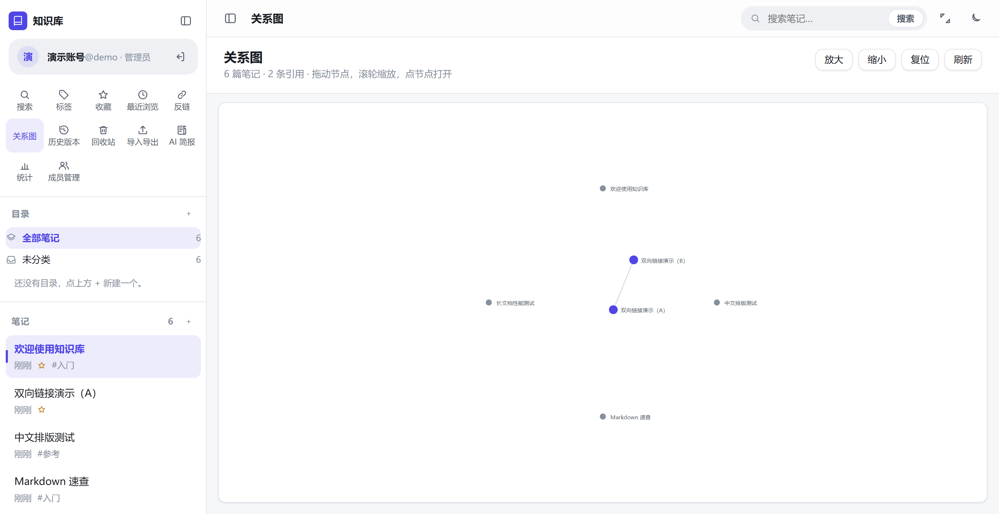

---

## 八、插入图片

**最简单的方法**：截图后在编辑器里直接 `Ctrl + V` 粘贴。

图片会自动上传到你的知识库（放在 `data/uploads/` 里），并在光标位置插入一行图片代码。**不用手动选文件**。

也支持上传 PDF、文本、压缩包等附件（单个最大 20 MB）。

---

## 九、写错了怎么办

### 历史版本

每次你**改动正文或标题**，旧内容都会自动存一份。

点顶栏的「历史版本」，能看到所有版本：

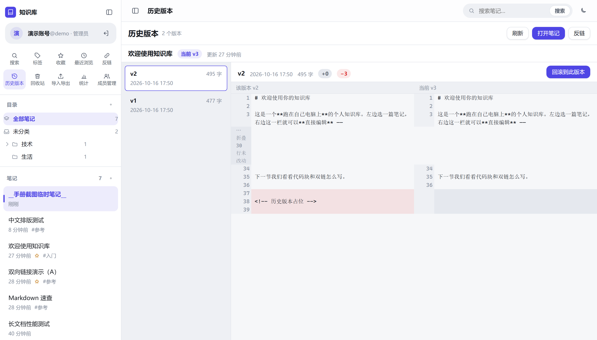

- 点左边某个版本 → 右边显示它和当前内容的**差异对比**（绿色是新增、红色是删除）
- 点「回滚到此版本」可以退回去

> 💡 **回滚不会丢东西**：你当前的内容会先被存成一个新版本，再切过去。所以怎么来回折腾都不会丢。
>
> 注意：只改「收藏/置顶/所属目录」这类设置**不会**产生版本 —— 只有真正改了文字才算。

### 回收站

删掉的笔记会进回收站，**不会立刻消失**。

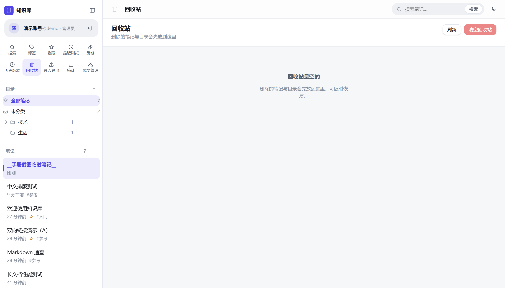

- **恢复**：放回原处，**标签和链接都还在**
- **彻底删除**：真的删掉，无法恢复（会二次确认）
- **清空回收站**：一次删光，会先告诉你将删掉多少篇

> 删除目录时，目录、它的子目录、以及里面的笔记会**一起**进回收站；恢复时也**一起**回来。

---

## 十、备份与换电脑

### 数据在哪

所有东西都在这个文件夹里：

```
data\kb.db          你的全部笔记、账号、标签、链接
data\uploads\       你上传的图片和附件
```

**把整个 `data` 文件夹复制走，就是完整备份。**

### 怎么备份

#### 自动备份（已经给你配好了，不用管）

系统每天 **12:30** 自动备份一次，放在 `backups\kb-年月日-时分秒\`，
**只保留最近 30 天**，更早的自动删掉（不然一年会堆 365 份）。

电脑当时没开也没关系 —— 开机后会自动补上这一次。

想看看备份有没有在跑：打开「任务计划程序」，找名字叫 `KB-Daily-Backup` 的那一项。

#### 手动备份

双击 `scripts\backup.cmd`，它会立刻复制一份到 `backups\` 目录下。

> ⚠️ **最稳妥的备份方式：先关掉知识库（关掉那个黑窗口），再备份。** 这样是 100% 一致的。
> 服务开着也能备份，但刚写进去还没落盘的那一瞬间的内容可能不在备份里。

> 💡 自动备份**只清理它自己生成的那些**（`kb-*` 目录）。你自己手动备份的、或者我帮你留的取证备份（`user-data-*`、`pre-opt-*`），它一律不动。

### 换电脑

1. 把整个知识库文件夹拷到新电脑
2. 新电脑上装 **JDK 21**（[下载地址](https://adoptium.net/zh-CN/temurin/releases/?version=21)，安装时勾选「Set JAVA_HOME variable」）
3. 双击 `scripts\start.cmd`，等它构建完
4. 打开浏览器，用原来的账号密码登录 —— 笔记都在

### 导出 / 导入

点顶栏的「导入导出」：

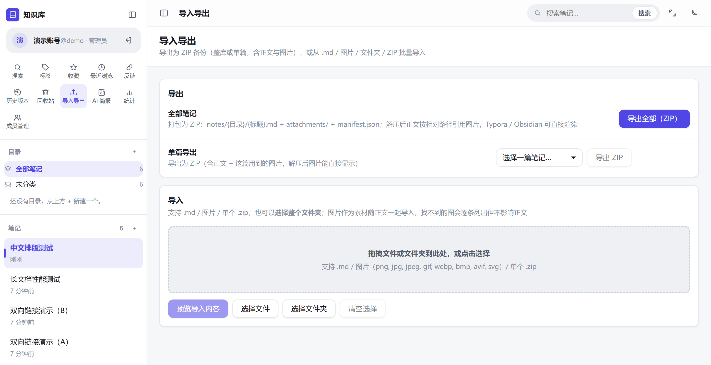

#### 从别的软件搬家（Obsidian / Typora / 语雀 …）—— **用「选择文件夹」**

这是最省事的办法，**图片也会一起搬过来**：

1. 点 **「选择文件夹」**
2. 选中你笔记库的那个**文件夹**（不是选单个文件）
3. 点「预览导入内容」，看看要导入什么
4. 确认没问题，点导入

> 💡 **为什么推荐选文件夹**：Markdown 里的图片写的是**相对路径**（比如 ``）。
> 只有把那个 `images/` 子目录一起选中，程序才知道图片在哪，才能把它们一起搬进来，并把正文里的引用改写成知识库自己的地址。
> **只选一个 `.md` 文件的话，图片搬不过来** —— 因为图片文件压根没被选中。

#### 其他几种方式

| 方式 | 怎么做 | 图片能搬过来吗 |
|---|---|---|
| **选文件夹** | 点「选择文件夹」（**推荐**） | ✅ 能 |
| **拖拽文件夹** | 把整个文件夹拖进虚线框 | ✅ 能 |
| **ZIP 包** | 选择或拖入一个 `.zip` | ✅ 能（只要包里图片与 md 的相对位置没变） |
| **多选文件** | 同时选中 `.md` 和图片 | ✅ 能（按文件名匹配；子目录结构会丢失） |

支持：`.md` / `.markdown` / 图片（png、jpg、jpeg、gif、webp、bmp、avif、svg）/ 单个 `.zip`。

#### 图片找不到时会怎样

某张图在选中的文件里找不到时，**不会导致导入失败** —— 那一篇照样导入，引用保持原样，同时**明确告诉你缺了什么**：

```
⚠️ 3 张图片找不到
   使用手册  第 12 行 | images/02-登录页.png | 文件集合里没有这个路径
   使用手册  第 18 行 | ../outside/x.png     | 路径非法
   使用手册  第 24 行 | note.png             | 不支持的图片类型
```

看到这个提示，**不用重新选文件再点一遍** —— 弹窗里有一个 **「改用选择文件夹」** 按钮，点它会直接打开文件夹选择器（并清掉你之前选的文件，避免两个来源混在一起）。

选上**包含 `images/` 的那个文件夹**，再预览一次，缺图就清零了。

> 提示里写着「这些图片在你电脑上是有的，只是这次没有被选中」——
> **这不是程序出错**。浏览器出于安全限制，**无法自己去你的磁盘上找图**，
> 所以必须由你把图片文件一起选上（选文件夹最省事）。
>
> 网上的图片（`https://…` 开头）不会被改动，也不算「找不到」。

#### 导出

两种都导成 **ZIP**，因为一个单独的 `.md` 文件**带不走图片**（图片是独立文件，Markdown 里只是路径引用）。

- **导出全部**：一个 ZIP，里面是
  ```
  notes/{目录}/{标题}.md      → 所有笔记
  attachments/                → 所有图片和附件
  manifest.json               → 清单
  ```
- **导出单篇**：一个 ZIP，里面是
  ```
  {标题}.md                   → 这一篇的正文（在包根）
  attachments/                → 只有这篇用到的图片
  manifest.json
  ```

**解压后直接就能看**：正文里的图片是相对路径，用 Typora、Obsidian、VS Code 打开都能正常显示 —— 不会出现「图片读取失败」。

> 导出的 `.md` 是通用格式，**用任何其他笔记软件都能打开**，不用担心被锁死在这个工具里。
>
> 💡 单篇 ZIP 里只有**正文实际引用到的**图片。如果你在正文里删过某张图，那个文件不会被打包（省体积）。

#### 把导出的东西再导回来（完整往返）

导出的 ZIP **可以直接导回来**，而且内容完整：

| 项目 | 往返后是否一致 |
|---|---|
| 正文 | ✅ 逐字一致 |
| 图片 | ✅ 字节一致，能正常显示 |
| 标签 | ✅ |
| 所在目录 | ✅（子目录路径也对） |
| 双链 `[[…]]` | ✅ 文本保留 |
| 标题 / 创建时间等元数据 | ✅ |

#### 一个提醒

导入是**新增**笔记，**不会覆盖**同名笔记。所以想重做一次导入，要先把上次导入的那些笔记删进回收站再重来 —— 否则会产生重复笔记。

#### 附件体检：发现「图片显示不出来」的根源

笔记里的图片是单独的文件，存在 `data\uploads\` 里。如果这个文件丢了（换电脑漏拷、磁盘出问题、误删），
正文里的图片就再也显示不出来，而**你只会看到一块空白**，不知道是哪儿的问题。

「导入导出」页面最底下有一块**「附件体检」**，点「检查附件」它会做三件事：

1. 数一数一共有多少个附件
2. **逐个核对磁盘上文件还在不在**，列出丢失的那些：原文件名、多大、属于哪篇笔记（点一下能直接跳过去）
3. 顺便找出磁盘上有、但数据库里没记录的「孤儿文件」

三种结果：

| 看到 | 意思 | 怎么办 |
|---|---|---|
| 「全部附件都在，没有断链」 | 一切正常 | 不用管 |
| 有「缺失」的条目 | 那些图片/文件确实丢了 | 重新上传一次同名文件即可恢复显示 |
| 「还没有上传过附件」 | 你还没传过图 | 正常 |

---

## 十一、让别人也能访问（公网）

**如果你只是自己用，可以跳过这一节。**

想要把知识库发给不在同一个网络的人看，双击 **`scripts\start-public.cmd`**。

它会先启动服务，再建立一条加密隧道，最后在屏幕上打印一个醒目的方框：

```
######################################################################
#  公网地址（把这个地址发给别人，他们就能访问）：
#      https://xxxx-xxxx-xxxx.trycloudflare.com
######################################################################
```

**把这一行地址发给别人就行**，对方用手机、电脑、任何浏览器都能打开。自带 HTTPS 加密，不用买服务器、不用改路由器。

> ⚠️ **注意事项**
> 1. 这个地址**每次重启都会变**，不是固定的
> 2. 任何人拿到这个地址都能打开登录页 —— **务必设强密码**
> 3. 登录连续输错 5 次会被锁 15 分钟
> 4. 关掉那个黑窗口，隧道就断了，地址随之失效
>
> 建议：**先在局域网里验证好，再开公网**。

---

## 十二、手机上用

同一个 WiFi 下，手机浏览器打开启动时打印的「局域网」地址（形如 `http://192.168.1.xx:8080`）。

手机上左栏会变成**抽屉**，点顶栏左边的「菜单」图标滑出来：

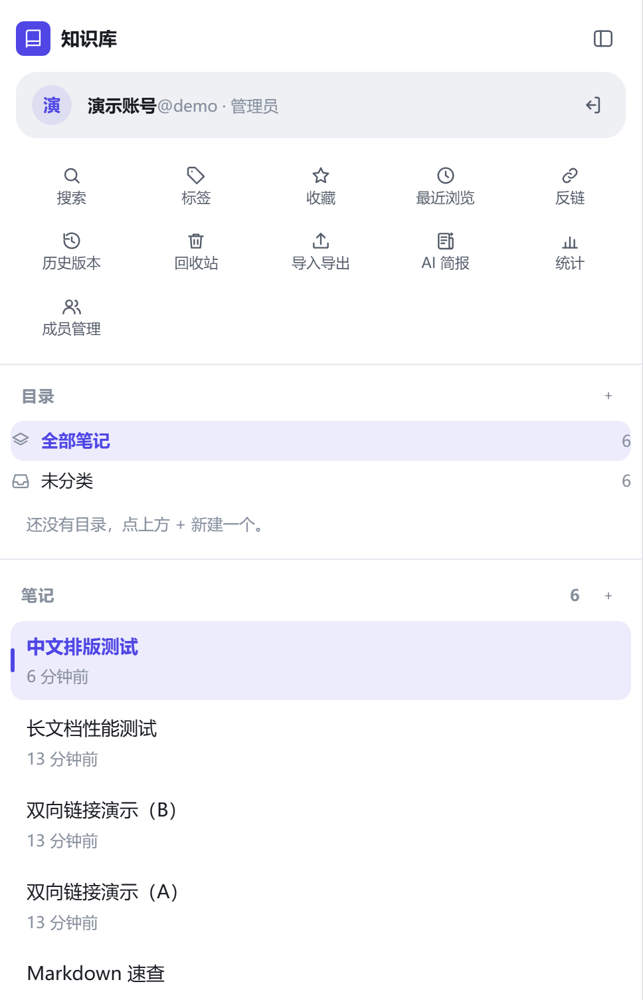

编辑区自动变成单栏，字号和行距都调整为方便阅读：


搜索、标签这些功能在手机上也一样能用，结果自动变成单列：

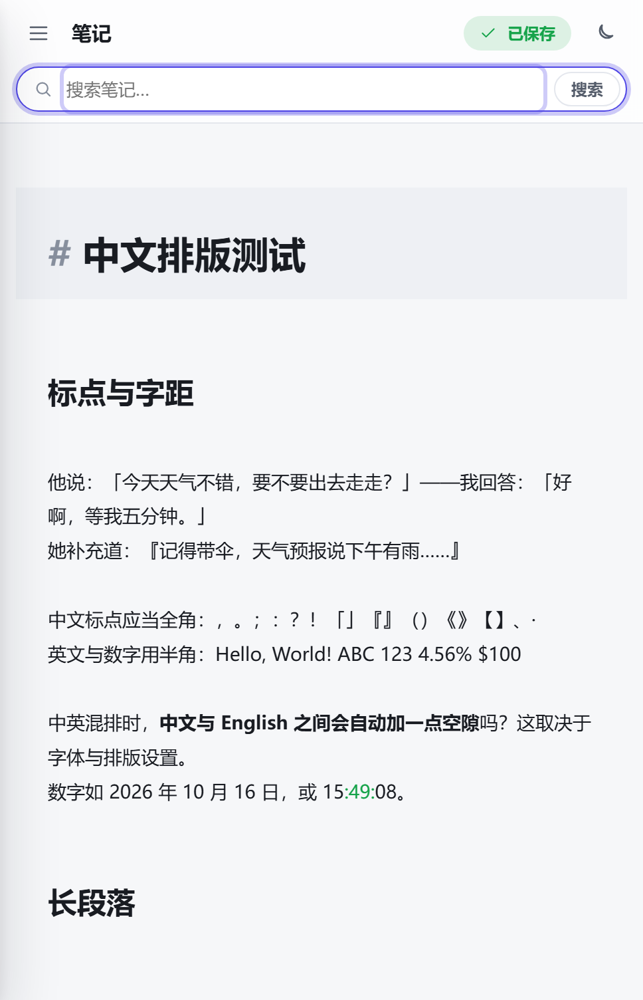

平板（横屏）上左栏常驻但更窄，编辑区更宽：

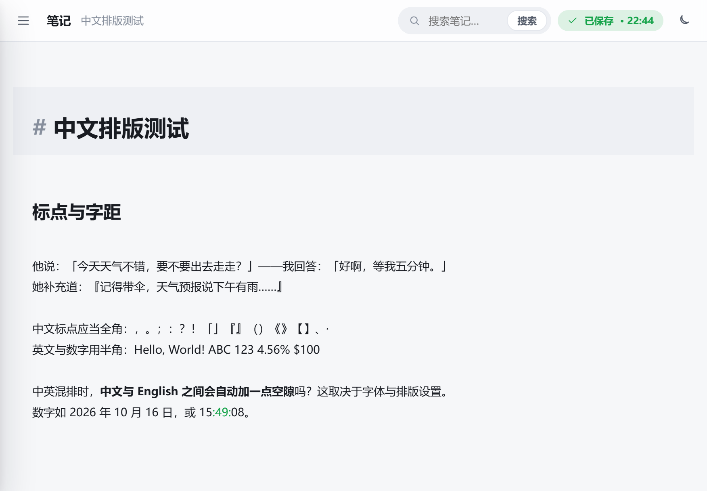

> 💡 如果手机打不开：多半是 Windows 防火墙拦了。第一次启动时会弹出「是否允许网络访问」，选**允许**；漏点了就到「Windows 安全中心 → 防火墙和网络保护 → 允许应用通过防火墙」里放行 Java。

### 把知识库放到手机桌面上（像个 App 一样）

手机上每次都要开浏览器、输地址太麻烦 —— 可以把它「添加到主屏幕」，之后点图标直接进，**没有地址栏**，像个原生 App。

**安卓（Chrome / Edge）**：

1. 用浏览器打开知识库地址
2. 右上角菜单 → **「添加到主屏幕」**（有的浏览器叫「安装应用」）
3. 桌面就会出现「知识库」图标

**iPhone（Safari）**：

1. 用 Safari 打开（**必须是 Safari**，微信里打开的不行）
2. 点底部的**分享**按钮
3. 选**「添加到主屏幕」**

### 断网了也能打开外壳

装到桌面之后，即使**完全没网**，打开也不会是浏览器的报错页 ——
会显示界面外壳和一条「当前离线」的提示条，已经加载过的页面还能看。

> ⚠️ 但**编辑和保存需要联网**（笔记在电脑上，不在手机里）。
> 断网时点搜索、翻笔记会失败，这是正常的 —— 它不会拿旧数据糊弄你。

---

## 十三、常见问题

**Q：黑窗口一闪就没了？**
说明启动出错。用命令行方式跑一次能看到错误信息：在 `scripts` 目录按住 Shift 右键 → 「在此处打开 PowerShell 窗口」→ 输入 `.\start.cmd`。

**Q：提示「没有找到 Java」？**
需要装 JDK 21：[下载](https://adoptium.net/zh-CN/temurin/releases/?version=21)。安装时**勾选「Set JAVA_HOME variable」**，装完重开黑窗口再试。

**Q：提示端口 8080 被占用？**
可能上次没关干净。按提示结束占用进程，或者直接重启电脑。

**Q：第一次启动特别慢？**
正常。要下载构建依赖，几分钟。之后就快了（几秒钟）。

**Q：写了一半断电/关窗口，内容会丢吗？**
不会。停止输入约 1 秒后就自动保存了。只有「刚敲完最后一个字就立刻断电」这种极端情况可能丢一两个字。

**Q：能不能离线用？**
能。除了「公网访问」需要联网建隧道，其他所有功能都是本地的。

**Q：笔记会不会被传到网上？**
不会。除非你自己开了公网访问。数据全在 `data\kb.db` 这一个文件里。

**Q：忘了密码怎么办？**
目前没有找回功能。如果还有别的管理员账号，让它帮你重置；如果只有你一个管理员，需要联系维护者处理数据库。

**Q：能同时开多个浏览器窗口吗？**
可以。两个人同时编辑同一篇笔记时，**后保存的会覆盖先保存的**，所以同一篇笔记别两个人一起改。

**Q：怎么彻底卸载？**
删掉整个文件夹就行。但 **`data` 文件夹里有你的全部笔记**，删之前记得备份。

**Q：界面上的「成员管理」是什么？**
给管理员用的：创建账号、发邀请码、停用账号。普通成员看不到这个入口。

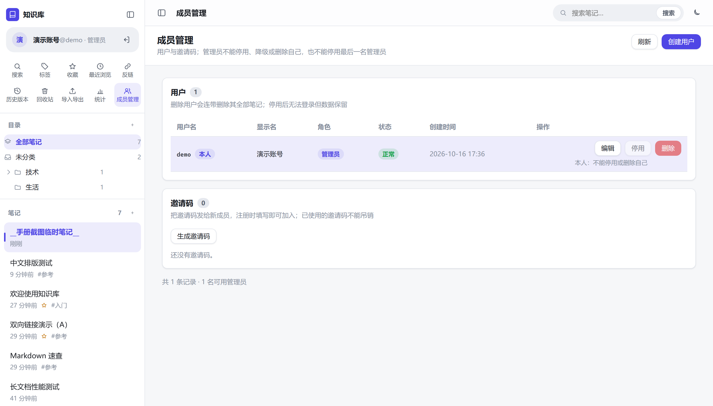

---

---

## 十三、自动生成的两份内容怎么读

知识库会自己往里写两类笔记：**每天一篇「AI 简报」**、**每周 10 篇「开源周报」**。
它们格式统一，扫一眼就能抓重点。

### AI 简报（每天 18:30）

存到 `AI时代笔记` 目录，标题形如 `AI 简报 2026-10-30`。每条都是固定的五段：

~~~
#### 1. 让网站更容易表达人工智能培训偏好        ← 中文标题（序号方便你记「第几条」）
> OpenAI · 10-30 · ★★★                     ← 来源 · 发布时间 · 重要级别

OpenAI将遵循共享的robots.txt信号，帮助网站运营商把…   ← 一句话摘要（超过 120 字会截断）

原题：Making it easier for websites to express AI training preferences   ← 英文原题
链接：https://openai.com/index/helping-websites-express-ai-training-preferences   ← 完整地址
~~~

**怎么快速扫**：只看 `>` 那一行。`★★★` 的优先看，`★` 的可以跳过。

**重要级别怎么来的**（不是 AI 判断的，是按固定规则）：

| 级别 | 什么情况 |
|---|---|
| ★★★ | OpenAI / Anthropic / DeepMind 的官方发布；或 Hacker News 上 300 分以上 |
| ★★ | 其他官方一手源；Techmeme；Hacker News 100 分以上；arXiv；量子位 / 机器之心 |
| ★ | 其余（含 Hacker News 分数不足 100 或无分数） |

> 简报末尾会写明这条规则。级别仅供参考，不代表内容质量高低。

**有些条目没有发布时间** —— 那是源站本身没给（比如 Anthropic、arXiv），不是漏抓。

### 开源周报（每周五 18:30）

存到 `开源周报/2026-W44` 这种按周分的目录，一周 **10 篇**（GitHub 5 + Gitee 5），一个项目一篇。

**想直接生成一份，或者看看这周抓了什么** → 侧栏「**开源周报**」→ 点「**一键获取本周周报**」

每篇的结构：

~~~
# [GitHub] Nutlope/hallmark

| 项目信息 | |          ← 一眼看完关键数据
|---|---|
| 本周新增 | **+12,062** ⭐ |
| 总星 | 44.3k |
| 语言 | CSS |
| 最近更新 | 10-29 |
| 本周榜位 | 第 1 名 |
| 仓库地址 | https://github.com/Nutlope/hallmark |

**一句话价值**：Claude Code、Cursor和Codex的防AI倾斜设计技能。
**推荐理由**：本周新增 12,062 颗星，位列 GitHub 周榜第 1；CSS 技术栈，评估成本低。
**适用人群**：前端与工具链开发者（按语言推断，仅供参考）。
~~~

**几条要知道的**：

- **缺字段就整行不显示** —— 没有的就不写，不会出现「未知」这种占位。
  比如 Gitee 首次收录还没有周增数据，「本周新增」那一行就整个不出现。
- **「适用人群」是按编程语言推断的**，仅供参考；语言识别不出来时这行不显示。
- **「最近更新」偶尔会消失** —— 它来自 GitHub 官方接口，未登录每小时限 60 次，
  短时间内反复点「一键获取」会用完额度；等一小时自动恢复，**不影响其他内容**。
- **同一周重复生成不会产生重复笔记**，已存在的会跳过。
- **每篇末尾有一段「傻瓜教程（自动生成）」** —— 0 这是什么东西 / 1 动手前先备好 / 2 安装 / 3 跑通第一个例子 / 4 三个容易踩的坑 / 5 想继续深入 / 6 原文速览（照抄 README 开头） / 7 备注。命令与代码块都摘自项目 README 原文，散文是模板；**没有替你执行过**，报错以 README 与 Issues 为准。只对之后新生成的周报生效，旧笔记不回溯。

---

## 附：一页速查

```
启动          双击 scripts\start.cmd
打开          双击 scripts\打开知识库.cmd  （或浏览器访问 http://127.0.0.1:8080）
备份          双击 scripts\backup.cmd      （建议先关服务）
公网          双击 scripts\start-public.cmd
数据位置      data\kb.db  和  data\uploads\
```

| 我想…… | 怎么做 |
|---|---|
| 新建笔记 | 点笔记列表的「+」 |
| 改格式符号 | 把光标移到那一行，符号就出来了 |
| 建链接 | 输入 `[[`，选一篇 |
| **看笔记之间的关系** | 侧栏「**关系图**」，滚轮缩放、点节点打开 |
| 传图 | 截图后直接 `Ctrl + V` |
| 找东西 | 顶栏搜索框，1 个汉字起搜 |
| **缩小搜索范围** | 搜索结果页顶部：目录 / 标签 / 日期 / 排序 |
| **看长笔记写了啥** | 正文上方的「速览（自动提取）」 |
| **查图片是不是丢了** | 导入导出页 →「附件体检」→「检查附件」 |
| 撤销误删 | 顶栏「回收站」→ 恢复 |
| 回到旧版正文 | 顶栏「历史版本」→ 回滚 |
| 把笔记挪个位置 | 在左栏直接拖 |
| 换主题 | 顶栏最右边的月亮/太阳 |
| **手机当 App 用** | 手机浏览器打开 → 菜单 →「添加到主屏幕」 |
| **确认备份有没有在跑** | 任务计划程序里看 `KB-Daily-Backup`（每天 12:30） |
